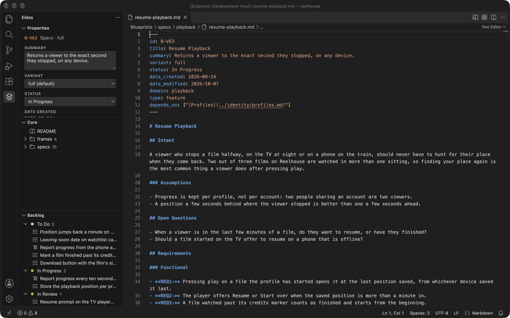
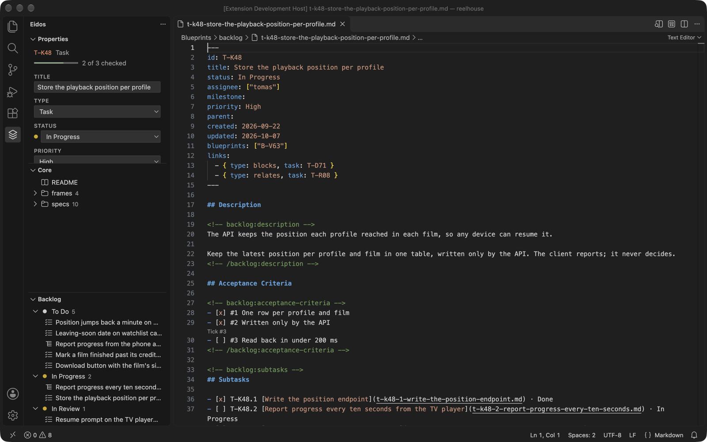
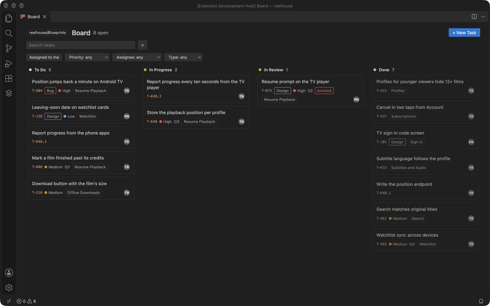
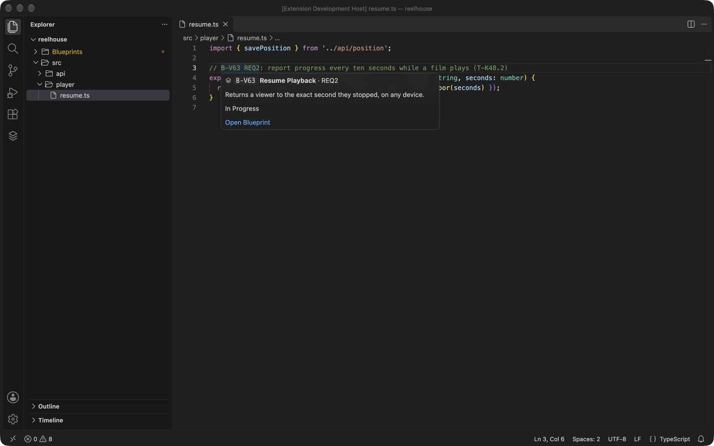
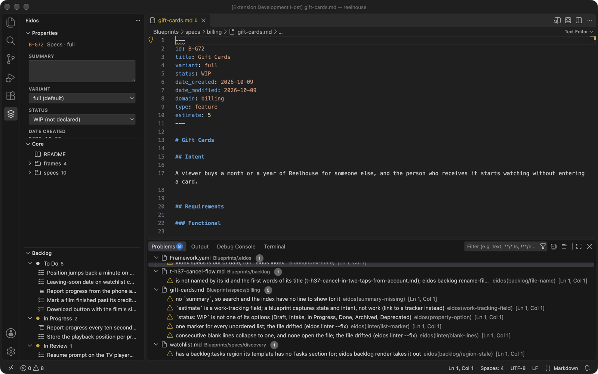

# Eidos MD for VS Code

The developer's workflow with [Eidos](https://eidosmd.com) without leaving the editor: the specs and tasks that
say what to build in a sidebar, edited in VS Code's own markdown editor with a Properties panel beside them, a
board of the backlog, `eidos check`'s findings in Problems, and blueprint and task ids that hover and open
anywhere in the workspace.



It turns on in a workspace folder holding an Eidos project (a `.eidos/` folder at the folder or beneath it), and
it stands where any outside tool could: every read is a command of the `eidos` CLI run with `--json`, and every
write is the command a person would run, so a project changed from VS Code is the same as one changed in Eidos
MD or from the shell. Authoring the Core (new blueprints, moving them, the framework) stays in Eidos MD and the
CLI.

It needs the `eidos` CLI, 0.22 or later, and offers to install it when there is none (see
[Which eidos it runs](#which-eidos-it-runs)).

## What it adds

- **The Eidos activity**: **Properties**, which follows the blueprint or task open in the editor and edits its
  frontmatter as a form typed by the framework (a select for an option list, a status, or a priority, chips for a
  list, the id and the stamped dates read-only); **Core**, each collection's blueprints by category; and
  **Backlog**, the tasks by status in board order, filtered by board, milestone, assignee, **Assigned to me**, and
  a search.
- **Open Board**: the backlog's board in an editor tab. Drag a card to another column to set its status.
- **In a task**: a CodeLens to tick each open checklist line (`eidos backlog check`) and to append a note
  (`eidos backlog set --append`).
- **Problems**: `eidos check`'s findings on the files they name, refreshed on save.
- **Ids**: `B-A45` or `T-W85` anywhere hovers with its title, summary, and status, and opens with Go to Definition
  or a ⌘-click; `B-A45 REQ6` opens at that requirement.
- **Open in Eidos**: the blueprint or task open in the editor, at its page in Eidos MD (0.22 or later), by the
  app's `eidosmd://open` link.
- **Go to Blueprint**, **Go to Task**, and **New Task**, and every action as an `Eidos:` command.

A write is never made over unsaved edits: the extension asks you to save the file first.

**A task**, with its status, priority, and checklist in Properties and a CodeLens to tick the next line:



**The board**, a column per status, filtered as the Backlog view is:



**An id in code** hovers with the blueprint's title, summary, status, and the requirement it names:



**`eidos check`** in Problems, on the files each finding names:



The pictures show Reelhouse, a made-up streaming product.

## Which eidos it runs

The extension runs the `eidos` CLI you installed, 0.22 or later (the version `package.json` names under
`eidos.minimum`). It looks for it on the PATH, then where the install script puts it (`~/.local/bin`, or
`%LOCALAPPDATA%\Programs\eidos` on Windows). When there is none, the Eidos sidebar offers **Install the Eidos
CLI**, which runs the CLI's own install command in a terminal:

```bash
curl -fsSL https://eidosmd.com/install | sh
```

On Windows it runs `irm https://eidosmd.com/install.ps1 | iex`. When the one installed is older than the
extension reads, it offers **Update eidos**, which runs `eidos version update`. The setting **Eidos: Path**
(`eidos.path`) points it at an `eidos` installed elsewhere, or one being developed.

In a project, `eidos` runs as the version the project pins (`eidos version pin`), as it does in a terminal, so
VS Code, the shell, CI, and agents all write with one version. A project pinning a version older than the
extension reads runs as the installed `eidos` instead, and the extension says so once.

## Develop

```bash
pnpm install
pnpm build
pnpm check              # TypeScript
pnpm test               # unit tests
pnpm test:host test/host/project   # the Extension Development Host checks, on a copy of the project (any Eidos project works)
pnpm package            # the VSIX, one for every platform
node scripts/screenshots/run.mjs <project>  # the poses the README's pictures show, for capturing them again
```

The tests and a development build run the `eidos` you installed. Press F5 with the repository open to run it in
an Extension Development Host.

What the CLI does not publish yet, and how the extension stands in for it, is in [docs/gaps.md](docs/gaps.md).

## Release

A release is a version tag. Set `version` in `package.json`, add its entry to `CHANGELOG.md` (the release notes
are read from it), commit, and push `v<version>`: the Release workflow tests, packages the VSIX, attaches it to
the tag's GitHub release, and publishes it to Open VSX by trusted publishing. Run by hand from
Actions, it only tests and packages.

## License

The extension is MIT (see [LICENSE](LICENSE)). It carries no part of the `eidos` CLI, which you install on its
own under its own license.
